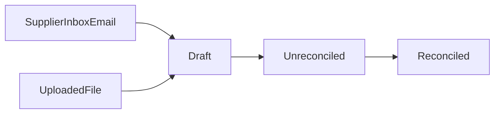

# Moldova Settlements plan

The app accepts payment-system registers (NovaPay, MegaMega, MAIB POS, and later sources) and allocates them against the books that already exist. The module is already there: `Moldova Settlements`.

## Boundaries

- Inbox only delivers the email. The handler is registered on the `inbound_email_handlers` hook and is not a required dependency: a register can also be created from an uploaded file.
- `erpnext_moldova_banking` ends at Bank Transaction. Customer rows do not land on Bank Transaction.
- `required_apps = ["erpnext"]`. There is no hard dependency on inbox or banking.

Posting depends on whether the fee reaches the bank statement.

**NovaPay and MegaMega.** The fee is kept before the transfer, and the account receives the net.

1. The net is one Bank Transaction on the clearing account.
2. A Payment Entry from clearing to the customer is for the full payment amount.
3. The difference left on clearing is the fee. One Journal Entry: debit bank charges, credit clearing.

Check: customer payment total = deposit net + fee.

**MAIB POS.** The bank deposits the payment amount without deducting the fee. It debits the fee as a separate transaction. The deposit date comes from the register row, from `DataTransferului`. The parser groups payments only by that date. If several days in the file already sit on one `DataTransferului`, that is one group. Different dates stay different groups.

The September `decontat` is like that. `2026-09-07` is one date, and inside it are transactions from 4–6 September: a transfer of 21311.30 and a fee of 295.93. `2026-09-12` and `2026-09-13` stay two dates.

1. One monthly `decontat` is one register. `autorizat` is not posted. Payments inside the register are grouped by `DataTransferului`.
2. A group has two amounts taken from file fields, without deriving one from the other. The transfer amount is the sum of `SumaTranzactiei`, and it sits on the deposit row together with one incoming Bank Transaction. The fee amount is the sum of `Commission`. The bank debits it in several transactions, by card type: for `2026-09-08` those are 23.46 and 57.83, which add up to 81.29, exactly that date’s fee in `decontat`. Both debits are labelled “Retinerea comisionului-operatiunile acceptare card”, one Visa and one MasterCard. “Comision acceptare MIA” and “Com. Plati Ord.PJ Internet Banking” do not belong to this register.
3. The source has two independent settings. “Find submitted payments” turns on the Actions item “Match payment documents”: it links an empty row to a Payment Entry or to a paid POS Sales Invoice (`is_pos`, a `Sales Invoice Payment` row). It does not replace a link that was already set by hand. Submit does not call this item. “Create a payment if none is found” applies to a submitted register and creates a Payment Entry for the payment-amount field, only for a row that is still unlinked. With both flags off, the register posts only the fee and leaves the row unlinked.
4. For MAIB, creation is off by default. A card sale in POS is already paid by the invoice posting, and it has no separate Payment Entry. Creating a Payment Entry when the search misses would pay the customer a second time. Creation for MAIB can be turned on when the invoice carries `ReferintaTranzactiei`: without that reference, amount and time cannot tell a miss from a sale that already exists. For NovaPay and MegaMega, creation is on by default.
5. The morning MAIB deposit is matched to the document that already holds the amount: a found `Sales Invoice Payment` row or, if creation was on and no invoice was found, a new Payment Entry. The card payment lands on the clearing account. The incoming bank transaction moves that amount from clearing to the bank account. The mode-of-payment account and the Bank Account account are different accounts.
6. Fee and deposit are two child tables, one row per deposit date. The fee row holds Bank Transactions that are debits only. The deposit row holds a Bank Transaction that is a receipt only. NovaPay and MegaMega samples have one date, so each table has one row. The fee amount is the sum of the fee field. The transfer amount is the sum of the net field for NovaPay and MegaMega, and the sum of `SumaTranzactiei` for MAIB. On submit, NovaPay and MegaMega create a Journal Entry and write it onto the fee row. For MAIB, there is one fee row for each `DataTransferului` value. The register does not create its own fee Journal Entry. Debits are set by the user or by the Actions item “Match fee bank transactions”. The item takes that date’s debits labelled “Retinerea comisionului-operatiunile acceptare card” when their amounts add up to the row’s fee. Submit does not wait for those debits. If a debit is already set and its Bank Transaction has one reconciled Journal Entry, the register writes that entry onto the debit row. If not, the row waits for reconciliation. The item works in Draft and after submit, does not replace debits that are already set, and does not submit the register.
7. A payment row with no link keeps the register out of Reconciled.

Group check: the transfer amount and the fee amount equal the sums of the payment fields for that deposit date. On the report row, gross still equals fee + net, but the statement is matched to the transfer field, not to the difference of the other two fields.

**MAIB Ecomm.** Internet acquiring, terminal `E0103299`. Emails arrive separately from POS and become the source `MAIB Ecomm`. The account receives the net, and there is no separate fee debit. Posting is the same as NovaPay and MegaMega.

1. The net `Suma_net` is one Bank Transaction on the clearing account.
2. A Payment Entry from clearing to the customer is for `SumaTranzactiei`.
3. The fee is one Journal Entry on the `DataTransferului` date: debit the fee account, credit clearing. This fee has no Bank Transaction debits.

The payment fee and the date fee are already the sum of `Commission` and `ComisAuth`; `ComisAuth` is not stored on its own. In the 8 September email: 58.20 + 1.00 = 59.20, net 1,880.80. Exactly 1,880.80 arrived in the account. The Merchant Portal shows only `Commission` and a net of 1,881.80; the register is built from the email. Payment Entry creation is on by default, as for NovaPay. The daily header writes the period without hyphens, `20260909-20260909`; the register number is still `MAIB-E0103299-2026-09-09-2026-09-09`. The monthly number is `MAIB-E0103299-2026-09-01-2026-09-30`.

Daily registers and the monthly register of the same source live together. The same RRN is saved in the second register when the amount, fee, net, and `DataTransferului` match. On save, an empty row copies `payment_entry`, `sales_invoice`, and the customer from the other register and does not mark them as created here. A fee row and a deposit row copy the Journal Entry and the Bank Transaction only when that date has the same set of RRNs and the same day totals in both registers. A day that matches only in part does not copy the entry and does not get a new one on submit: otherwise the day’s fee would be posted twice. Submit creates a fee Journal Entry for a row that is still unlinked, and it does not create a Payment Entry. Cancel cancels only the documents this register created, and it does not go through while another register holds a copied link: the register that copied the link is cancelled first. The Coverage field shows two mismatches inside this register’s dates: an RRN that exists in another register and is missing here, and an RRN that exists here but in no other MAIB Ecomm register.

Submit is acceptance of the supplier’s report. It does not wait for Payment Entry, Sales Invoice, or Bank Transaction. For NovaPay, MegaMega, and MAIB Ecomm, submit posts a Journal Entry onto the fee row. For MAIB POS, submit does not create a fee Journal Entry and does not wait for debits. If a debit is already set, the row receives the Journal Entry already reconciled with its Bank Transaction. Payments are created after acceptance. Reconciliation starts after submit and proceeds by hand, automatically, or both. The Actions item “Match payment documents” links a row only when exactly one suitable document is found, and it does not submit the register. If there are several candidates, or the invoice has no terminal number, the row stays empty. The register becomes Reconciled when the deposit Bank Transaction is reconciled and the payment rows are linked. MAIB POS also needs debits whose sum equals the fee, and each of those Bank Transactions in status Reconciled.

- NovaPay, MegaMega, and MAIB Ecomm: a Payment Entry, found or created, takes the payment-amount field. The Journal Entry takes the row’s fee field. Matching against the statement uses the net field. For MAIB Ecomm that is `Suma_net`, and the row’s fee already includes `ComisAuth`.
- MAIB POS: deposit matching takes `SumaTranzactiei` and closes the linked `Sales Invoice Payment` or the created Payment Entry. The fee row stores the sum of `Commission`. That date’s debits are separate rows, one Bank Transaction each, adding up to that fee. `Suma_net` is stored and is not written into these documents.

## Documents

One DocType for every system.

**Settlement Register** (label “Payment register”):

- source: NovaPay, MegaMega, MAIB POS, MAIB Ecomm; new sources are added to the Select and as a separate parser
- company, clearing account (Account), fee account
- register date, currency
- payment total, fee, net: sums of the matching row fields, without deriving one field from the others
- link to Supplier Inbox Email, when the register arrived by mail
- status: Draft, Unreconciled, Reconciled
- child table of payments
- child table of fees
- child table of deposits

On the Connections tab the register shows Journal Entry, Payment Entry, Bank Transaction, Sales Invoice, and Supplier Inbox Email from its own links. Payment Entry and Sales Invoice come from the payment rows and, when a deposit was posted by one such document, from the deposit rows. Journal Entry comes from the fee-debit rows and from the deposit rows. A debit Bank Transaction comes from the debit rows; an incoming Bank Transaction comes from the deposit rows. Supplier Inbox Email comes from the register header. Reverse fields are not added on Journal Entry, Payment Entry, Bank Transaction, or Sales Invoice. A repeated link to the same document is shown once.

**Settlement Register Payment** stores the supplier file’s columns. The shared money fields are filled from a column, not calculated from each other: payment amount, fee, net. For NovaPay those are “Accepted payment amount”, “Withheld fee amount”, “Amount to transfer”. MegaMega has the same three columns; the net is labelled “Amount to transfer”. For MAIB POS they are `SumaTranzactiei`, `Commission`, `Suma_net`. For MAIB Ecomm the payment amount is `SumaTranzactiei`, the net is `Suma_net`, and the fee is `Commission` plus `ComisAuth`.

The other columns of the row also sit on this table as their own fields:

- NovaPay: row number, transfer date, acceptance date, full name, shipment number
- MegaMega: row number, acceptance date, transfer date
- MAIB: TerminalID, ReferintaTranzactiei, NumeTerminal, DataTranzactiei, DataTransferului, Tip_Tranzactie, Valuta, NrCARD, SumaNumerar, SumaReversa, ReversSumaNumerar, ComisionReversat, Instant_Discount

A payment row has links `settlement_register_fee` and `settlement_register_deposit` to the fee and deposit rows of the same register with the same date. The parser sets them; they are not picked by hand.

The row has two separate Link fields: `payment_entry` to Payment Entry and `sales_invoice` to Sales Invoice. The second field is the POS invoice: `is_pos`, payment already on `Sales Invoice Payment`. There is no separate “POS Sales Invoice” DocType. These links are not in the files. Only one of the two links may be filled, otherwise the row does not save. These fields and the Customer field stay editable after submit: matching happens on an accepted register. While both links are empty, the customer can be set, changed, or cleared. If the customer is empty and a payment or an invoice is chosen, the row receives that document’s customer. If a customer is already chosen, the Payment Entry and Sales Invoice lists are filtered by that customer. A link to another customer’s document is not saved. While a link is set, the customer field is read-only. In the grid the row has a non-editable bullet. It is green when `payment_entry` or `sales_invoice` is filled. It is yellow when both fields are empty, the source has Payment Entry creation turned on, and creation has what it needs: Customer, payment amount, and clearing account. The “Create missing payments” item on a submitted register will create the document. Customer comes from the row. The default customer is written into an empty row on save and then limits the choice until it is changed or cleared. The bullet is red when there is no link and one cannot be created. The Payment Document and Payment Document Name pair is not used.

The register form has one Actions menu. In Draft and on a submitted register it holds the matching items: “Match payment documents”, “Match fee bank transactions”, “Match deposit bank transactions”. On a submitted register, when the source has creation turned on, there is also “Create missing payments”. The payment item is visible when the source has search turned on. The Bank Transaction items are visible for MAIB POS. Matching items fill empty links only, do not change a manual choice, and do not submit the register. A draft does not create journal entries or payments. A payment that is already linked is not given to a second row. Payment search is limited to the row’s customer. If the customer is empty and exactly one Payment Entry or POS Sales Invoice is found, the row is linked to it and the row’s customer is taken from that document. Search does not replace a customer that was already chosen. Submit does not call these items.

Row uniqueness: NovaPay + shipment number, MAIB + ReferintaTranzactiei. MegaMega has no external number in the file, so the key stays weak: acceptance date + transfer date + payment amount.

The register number is computed from the file data and stored in its own field. The document name is the series `STR-.YYYY.-`. The screen and the links show the register number. A repeated upload and a repeated email look up the register by this number, not by the document name. An existing draft or submitted register with the same number does not create a second document. A cancelled register does not hold the number: the same file creates a new series document.

- NovaPay: `NP-` and the number from the file name, `NP-00000008204`. If the name has lost the number, creation is still blocked: the system already has a register with the same set of shipment numbers.
- MegaMega: `MM-`, transfer date, payment amount, and acceptance date. The file has no other number.
- MAIB `decontat`: `MAIB-`, TerminalID, and the period from the report header, `MAIB-S0101949-2026-09-01-2026-09-30`. For Ecomm, a period `20260909-20260909` is read as the same dates. An `autorizat` file does not create a register.

**Settlement Register Fee**:

- deposit date
- fee amount: the sum of the fee field of the payments for that deposit date
- `journal_entry`: NovaPay, MegaMega, and MAIB Ecomm. On submit, the Journal Entry created by the register is written here. For MAIB POS this field stays empty: the Journal Entry sits on each debit row

In the fee grid the row has a non-editable bullet. For MAIB POS it is green when debit rows exist, the sum of their Bank Transactions equals the fee amount, and each Bank Transaction is in status Reconciled. It is red in every other case. MAIB POS has no yellow. For NovaPay, MegaMega, and MAIB Ecomm it is green when a Journal Entry is already written. It is yellow when there is no Journal Entry yet, but the date, fee amount, clearing account, and fee account are filled. It is red when one of those fields is missing.

**Settlement Register Fee Debit** holds the debits of one MAIB fee row. NovaPay and MegaMega do not have this table.

- fee row
- debit amount
- `bank_transaction`
- `journal_entry`: the Journal Entry already reconciled with this Bank Transaction is written here when the debit is set on save or on submit. Until there is a debit, accepting the register does not wait for it

One date can have two or more such rows. A second debit with the same Bank Transaction is not added.

**Settlement Register Deposit** is one row for the same deposit date as the fee.

- deposit date
- transfer amount: for NovaPay, MegaMega, and MAIB Ecomm the sum of the net field, for MAIB POS the sum of `SumaTranzactiei`
- `bank_transaction`: the incoming Bank Transaction. Set by hand or by the “Match deposit bank transactions” item. In Draft and after submit the item fills an empty link only and does not submit the register
- `payment_entry` or `journal_entry`: one field is filled, from the document this Bank Transaction is already reconciled with. If the Bank Transaction has several Sales Invoices, those links stay on the payment rows, and the deposit row stores the Bank Transaction

The deposit row’s bullet is green when a Bank Transaction is set and its status is Reconciled. It is red when there is no link or the status is something else. There is no yellow: the register does not create the deposit document.

There is no separate fee row per payment. The menu item is visible for MAIB POS in Draft and after submit, adds the missing debits, and leaves the ones already set alone. MAIB POS submit is not rejected because debits are empty or unreconciled. Reconciled is not set without them.

**Status** is a single field. Submit and the fee do not get their own values.

- **Draft.** The register is not accepted. Payment, fee, and deposit rows are filled. A row can only be linked to an existing Payment Entry, POS Sales Invoice, or Bank Transaction. The register does not create journal entries or payments. There is no fee Journal Entry yet, unless another MAIB Ecomm register copied one.
- **Unreconciled.** The register is accepted. For NovaPay, MegaMega, and MAIB Ecomm the fee Journal Entry is created and written onto the fee row, except a partially matching MAIB Ecomm day: that day does not get a second entry. MAIB POS has no fee Journal Entry of its own, and debits may still be missing. Payments and the deposit may still be unlinked.
- **Reconciled.** The fee posting from Unreconciled is kept. Every payment row is linked to a Payment Entry or to a paid POS Sales Invoice. Every deposit row’s incoming Bank Transaction is reconciled. For MAIB POS, the date’s debits add up to the fee amount and each Bank Transaction is in status Reconciled.

## Settings

One Single DocType. A settings row is a company and a source. Accounts are copied from it into a new register; on a draft they can be changed. A submitted register keeps its own accounts and no longer depends on the settings.

On each row:

- company
- source: NovaPay, MegaMega, MAIB POS, MAIB Ecomm
- clearing account. For NovaPay, MegaMega, and MAIB Ecomm this is the Payment Entry account and the credit of the fee Journal Entry
- fee account. For NovaPay, MegaMega, and MAIB Ecomm this is the Journal Entry debit. For MAIB POS it is unused: the register does not create the fee Journal Entry
- bank account, MAIB POS only. The menu item looks up that date’s fee and deposit Bank Transactions against it
- mode of payment. When set, Payment Entry search for registers of this source keeps only payments with this mode. For MAIB POS the same mode also limits POS Sales Invoice. The mode-of-payment account is the clearing account the card payment lands on. The bank account is the current account the bank moves the amount onto from clearing
- find submitted Payment Entries and paid POS Sales Invoices. Turns on the Actions item “Match payment documents”. On by default
- create a Payment Entry on a submitted register when no link is found. On by default for NovaPay, MegaMega, and MAIB Ecomm, and off for MAIB POS
- default customer. On save it is written into a payment row that has no customer. Until a payment and an invoice are linked, it can be changed or cleared. A chosen customer limits search and the lists, and it is not replaced by the customer of a found document. An empty customer is filled from the chosen payment or invoice

Creating a Payment Entry requires a Customer on the row and is done by an Actions item after acceptance, not on submit. If the customer is still missing after the default customer, the row stays without a Payment Entry. The Journal Entry cost center is taken from the company.

## Samples

Files live in `erpnext_moldova_settlements/examples`. In all three sources a row already contains the payment amount, the fee, and the net. The parser copies those numbers into their own fields. The match “amount = fee + net” is a check of the file, not a way to fill an empty field. A money cell with float noise is stored at 2 decimal places, without recalculating it from the neighbouring column: MegaMega `127.968` is stored as 127.97. Matching Customer and Sales Invoice is still not fixed: NovaPay has only a full name, and MegaMega and MAIB have no buyer.

**NovaPay** — 11 files, 12 rows (`№00000015659` has two rows, the rest one each). The recipient is `Hotel Life SRL` everywhere. Sheet `TDSheet`, labels in column B, header values in E.

- Header: recipient, bank account, date (`dd.mm.yyyy`). The bank account in the samples is the word `Основной`, not an IBAN: the clearing account is not taken from the file.
- Row: transfer date (C), acceptance date (D), payment amount (E), fee (F), amount to transfer (G), full name (H), shipment number (I). The net label has the typo “Сума”.
- The external row number is the shipment number. All 12 in the samples are unique: `SHMD…` and one numeric `80000001284182`.
- The register number exists only in the file name (`Реестр платежей №00000008204`); it is not in the cells. The row idempotency key is NovaPay + shipment number.
- The fee in the samples is exactly 2.5% or 3%. The transfer date matches the header date. One file is one deposit date.

**MegaMega** — 2 files, one row each. The same sheet `TDSheet` and the same labels, but the date columns are swapped relative to NovaPay, so a shared parse by column index is impossible.

- Header: recipient `"HOTEL LIFE" S.R.L`, account `MD46AG000000022516020091`, date as an Excel serial (`46209` = 2026-07-06, `46251` = 2026-08-17).
- Row: acceptance date (C), transfer date (D), amount (E), fee (F), net (G). No full name and no external number.
- The fee in both files is 18.6%. In the file, `127.968` and `560.032` are floats; the register stores 127.97 and 560.03.
- The header date is not always the transfer date (register dated 2026-08-17, transfer 2026-08-05). The Bank Transaction uses the row’s transfer date.
- The file name is generic (`Реестр платежей.XLSX`) and there is no register number. The row key is still weak: MegaMega + acceptance date + transfer date + amount.

**MAIB POS** — two monthly files for 2026-09, sheet `MDL`, terminal `S0101949`, currency MDL. Header on row 4, then `Total`, then a `Lista de totaluri` block (a summary by transaction type; it is not posted).

- `decontat` — settled in the period: 89 transactions, 27 `DataTransferului` dates, gross 105767.70, fee 1422.31, net 104345.39.
- `autorizat` — authorized in the period: 80 transactions, gross 97301.70, fee 1233.17, net 96068.53.
- The overlap is 79 references, and the amounts match. Only in `decontat`: 10 transactions from 28–31 August, settled on 2026-09-01. Only in `autorizat`: one transaction on 2026-09-30, settled on 2026-10-01.
- Both emails arrive together, and the columns and amounts of the shared rows match. The register is built from `decontat`. `autorizat` is gathered by authorization date and does not match the morning deposits: at the September boundary it drops 2026-09-01 for 8506.00 (10 transactions from 28–31 August) and adds 40.00 that the bank settled only on 2026-10-01. The inbox hook returns `None` for an `autorizat` email.
- Row columns: TerminalID, ReferintaTranzactiei, NumeTerminal, DataTranzactiei, DataTransferului, Tip_Tranzactie, Valuta, NrCARD (masked), SumaTranzactiei, Commission, SumaNumerar, Suma_net, SumaReversa, ReversSumaNumerar, ComisionReversat, Instant_Discount.
- The external number is ReferintaTranzactiei, unique inside the file and stable across the two reports.
- The fee is already on the row: InterIntra 2.5%, On us / Local / Friendly 1.2%. Cash, reversals, and the discount are zero in the samples; a non-zero reversal is not posted as a customer payment.
- There is no buyer. The parser groups payments by `DataTransferului` and sums `SumaTranzactiei` and `Commission` for the group. `2026-09-02`: transfer 260.00 and fee 3.12. `2026-09-07`: transfer 21311.30 and fee 295.93, because 4–6 September already sit on that date in the file. `2026-09-12` and `2026-09-13` stay two groups.

**MAIB Ecomm** — three emails, sheet `MDL`, terminal `E0103299`, terminal name `www.hotel-life.md`. POS columns plus `ComisAuth`, `Depozit`, `SumaTranzactieiMDL`, `SumaReversaMDL`, `ComisAuthReversat`, `ApprovalCode`. In the daily emails `Instant_Discount` comes before `ApprovalCode`; in the monthly email it comes after. The parser reads columns by name. The presence of `ComisAuth` tells the file apart from POS.

- `decontat20260909`: one operation `625107054986`, 2026-09-08, deposited 2026-09-09, 1940.00, `Commission` 58.20, `ComisAuth` 1.00, net 1880.80. The register fee is 59.20.
- `lunar_decontat20261002`: the same RRN and the same deposit date. The monthly register copies the daily register’s documents and does not create its own posting for that day.
- `decontat20261017`: `628918131447`, 2026-10-16, deposited 2026-10-17, 640.00, fee 12.16 + 1.00, net 626.84.

## Parsers and posting

A system’s parser reads its own file and fills the shared register. The first frame is a manual file upload on the register, and an inbox hook that returns `{"doctype": "Settlement Register", "name": ...}` or `None` when the email is not its. Document idempotency is held by the handler, not by inbox.

Actions menu items, in Draft and after submit, fill empty payment links, empty fee Bank Transactions, and empty deposit Bank Transactions. They do not replace a manual choice. Submit does not call the menu. For NovaPay, MegaMega, and MAIB Ecomm, submit creates a Journal Entry on the fee row. For MAIB POS, submit does not create a fee Journal Entry, does not wait for debits, and writes onto the debit row the Journal Entry from its Bank Transaction when that entry is already reconciled. A Payment Entry for the payment-amount field is created by a separate item on the submitted register, and only for rows that are still unlinked. Running it again does not create a second Journal Entry and does not take a payment that is already linked. Document amounts are not calculated from neighbouring fields.

Cancelling a register cancels only the Payment Entries and Journal Entries that the register itself created. A found POS Sales Invoice, and a Journal Entry already reconciled by the banking automation, stay submitted. The link is removed from the register. The register does not cancel the Bank Transaction.

## Translations

Interface labels are written in English in the DocType and in messages. Translations live in `erpnext_moldova_settlements/translations/ru.csv` and `erpnext_moldova_settlements/translations/ro.csv`. Russian and Romanian cover the register title “Payment register”, the fields, the statuses Draft, Unreconciled, and Reconciled, the Actions menu items, and the messages a user sees. Field names and the register number are not translated.

## Checks

Tests run only on a separate test site, not on the dev site. Do not run tests until that site is confirmed. On it, check: loading a file again does not duplicate rows; the payment amount, fee, and net on the row equal the file cells; NovaPay and MegaMega have one fee row; submit creates one Journal Entry on it and sets Unreconciled without a Payment Entry. MAIB fee rows are grouped by deposit date. MAIB POS submit succeeds without debits, does not create its own Journal Entry, and writes a Journal Entry onto the debit row only when the Bank Transaction is already reconciled. The bank-transaction matching item adds the missing debits and does not change the ones already set. The search item fills an empty row and does not change a Payment Entry or POS Sales Invoice that is already set. Search does not replace a chosen customer. Submit does not start the search and does not create a Payment Entry. A found payment is not created a second time. With creation off, an unlinked row does not move the register to Reconciled. The create item on a submitted register makes a Payment Entry equal to the payment-amount field. For NovaPay and MegaMega, matching uses the net field. For MAIB, deposit matching uses `SumaTranzactiei` and debit matching uses `Commission`. Creation for MAIB stays off in this test until the invoice has `ReferintaTranzactiei`.
